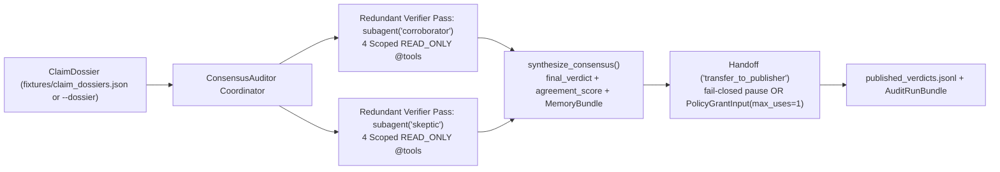

# Cortensor OpenMinion 0.1 Redundant Consensus Verifier & Building-Block Probe Suite

[](LICENSE)


A Cortensor Hackathon #5 reference application built on **`openminion==0.1.21`** (`MIT` License) that turns ambiguous prediction-market / oracle claims (`ClaimDossier`) into evidence-backed **`ConsensusVerdict`** bundles through isolated dual-perspective `subagent()` passes, portable **`MemoryBundle`** session handoff, and approval-gated **`Handoff`** publication — accompanied by an automated **10-probe OpenMinion SDK harness** calibrated against live LLM inference.

---

## Architecture



### Core Guarantees

- **Zero Global Pollution & Zero-Secret Persistence**: Isolated `home_root` (`.openminion/agents.json`) and `data_root` (`.openminion-state` SQLite/Alembic DBs) per workspace; runtime config persistence explicitly scrubs plaintext API keys (`api_key=""`) so providers always resolve credentials from environment variables at runtime.
- **Scoped 4-Tool `READ_ONLY` Evidence Set (`build_scoped_verifier_tools`)**: Both `corroborator` and `skeptic` run in fresh isolated `subagent()` contexts (`parent_transcript_inherited=False`) equipped solely with 4 `@tool(min_scope="READ_ONLY", idempotent=True)` functions bound to the active CLI `--fixtures` catalog, inline `dossier.metadata["evidence_sources"]`, and SSRF policy:
  1. `load_delphi_market_fixture(claim_id)` — loads the bound `ClaimDossier` or custom `--fixtures` catalog entry.
  2. `search_public_evidence(query, limit)` — searches curated catalog + inline `dossier.metadata["evidence_sources"]`.
  3. `fetch_source_excerpt(source_id)` — retrieves full verifiable excerpts from merged catalog + inline sources.
  4. `fetch_public_url_excerpt(url)` — fetches and strips HTML (`<script>`/`<style>`/`<noscript>`) from public `http`/`https` URLs with SSRF protection (`allow_private_network=False` blocks loopback, private, link-local, CGNAT, DNS rebinding, and unsafe redirects).
- **Fail-Closed Publication Gating**: `ConsensusVerdict` publication routes through a `Handoff` peer agent (`transfer_to_publisher`) with `publish_consensus_verdict` gated by `@tool(dangerous=True, min_scope="WRITE_SAFE")`. Unapproved `--publish` defaults to `pause` (capturing `thread_id` snapshot for `resume_publication()`), `--approval-mode deny` blocks cleanly, and `--approval-mode allow_once` enforces one-time `PolicyGrantInput(max_uses=1)` + replay protection.

---

## Installation & Isolated Setup

Requires **Python 3.11+** with **`openminion==0.1.21`** strictly pinned in [`pyproject.toml`](pyproject.toml). Always install into a project-local `.venv`:

```powershell
python -m venv .venv
.\.venv\Scripts\python.exe -m pip install -U pip
.\.venv\Scripts\python.exe -m pip install -e ".[dev]"
```

Configure runtime paths and provider credentials strictly via environment variables (copy [`.env.example`](.env.example) to `.env`, never commit `.env`):

```powershell
Copy-Item .env.example .env
# Populate OPENAI_API_KEY / OPENAI_BASE_URL (or CORTENSOR_* vars) in your shell environment only
```

### Supported Provider Presets

| Preset | OpenMinion Catalog ID | Base URL Env Var | Default Timeout (s) | Wire Protocol Family |
|---|---|---|---:|---|
| `openai-compatible` | `openai` | `OPENAI_BASE_URL` | 60 | OpenAI `/chat/completions` (`Bearer`) |
| `cortensor-portal` | `cortensor-portal` | `CORTENSOR_PORTAL_URL` | 480 | `openai_chat` (`service_vendor="cortensor"`) |
| `cortensor-router` | `cortensor-router` | `CORTENSOR_ROUTER_URL` | 120 | Cortensor Router `/api/v2/completions` |

---

## Quickstart CLI Commands

### 1. Run a Multi-Pass Consensus Audit (with `allow_once` Publication & Optional `--fixtures`)

```powershell
cortensor-verifier audit `
  --claim-id delphi-btc-etf-2024 `
  --fixtures fixtures/claim_dossiers.json `
  --preset openai-compatible `
  --model grok-4.6 `
  --multi-pass `
  --session-id cal-btc-etf-01 `
  --publish `
  --approval-mode allow_once `
  --timeout-seconds 180 `
  -o artifacts/sample_audit.json
```

### 2. Run the 10 OpenMinion Building-Block Probes & Export Docs

```powershell
cortensor-verifier probe `
  --preset openai-compatible `
  --model grok-4.7 `
  --timeout-seconds 180 `
  --export-docs `
  --docs-dir docs
```

### 3. Render the English-Only 1080p Demo Walkthrough MP4

```powershell
cortensor-verifier render-demo `
  --sample-json fixtures/calibrated_sample_run.json `
  --duration-seconds 75 `
  --fps 10 `
  -o artifacts/cortensor_hackathon5_demo.mp4
```

`render-demo` produces a deterministic storyboard MP4 from a calibrated sample JSON (`1920x1080`, 100% English ASCII/Latin-safe UI, no CJK font dependencies). The narrated submission video linked above was recorded from a fresh live run instead.

### 4. Run the Verification Test Suite

```powershell
.\.venv\Scripts\python.exe -m pytest -q
```

Loopback tests exercise real `openminion==0.1.21` objects (`APIRuntime`, `Agent`, `subagent`, `Handoff`, `MemoryBundle`, `PolicyGrantInput`, `submit_turn`) over an ephemeral loopback OpenAI/Anthropic/Cortensor HTTP stub without mocking OpenMinion internals.

---

## Demo Video & Latest Live Run

- **Demo video (4:06, 1080p, narrated + captioned)**: https://github.com/huadeng408/cortensor-openminion-verifier/releases/download/v0.1.2/cortensor_hackathon5_demo.mp4
- Fresh live run shown in the demo (2026-11-16, `grok-4.6`, `delphi-btc-etf-2024`): verdict `SUPPORTED`, `agreement_score=0.975`, `mean_confidence=0.925`, `corroborator (0.95)` & `skeptic (0.90)`, `Handoff allow_once` `published=True`, `23` requests / `146,855` tokens / `439.4 s` model latency. The SSRF guard refused a live `sec.gov` fetch whose hostname resolved to a non-public fake-IP (`198.18.0.177`, local proxy DNS) and both passes fell back to curated primary sources. Raw bundle: [`fixtures/live_run_2026-11-16_grok-4.6.json`](https://github.com/huadeng408/cortensor-openminion-verifier/blob/main/fixtures/live_run_2026-11-16_grok-4.6.json), event trace: [`fixtures/live_run_2026-11-16_trace.jsonl`](https://github.com/huadeng408/cortensor-openminion-verifier/blob/main/fixtures/live_run_2026-11-16_trace.jsonl).

## Live Calibrated Benchmarks (`[Live LLM Calibrated]`)

All probe and audit figures below are captured directly in [`fixtures/calibrated_sample_run.json`](fixtures/calibrated_sample_run.json) with relay hostnames and credentials scrubbed:

### Building-Block Probe Suite (`BuildingBlockProbeRunner.run_all`)

- **Calibration Status**: `[Live LLM Calibrated]` (`openminion==0.1.21`, `preset=openai-compatible`, `model=grok-4.7`, `endpoint=https://<configured-openai-compatible-relay>/v1`)
- **Pass Rate**: `10/10` probes passed (`failed=0`)
- **Total Suite Latency**: `611,888.99 ms`
- **Empirical DX Findings Captured**: `10` verified behaviors recorded in [`docs/WHAT_WE_LEARNED.md`](docs/WHAT_WE_LEARNED.md) and [`docs/BUILDING_BLOCKS_TESTED.md`](docs/BUILDING_BLOCKS_TESTED.md)

### Dual-Pass Consensus Audit (`ConsensusAuditor.audit_claim`)

- **Fixture**: `delphi-btc-etf-2024` (`grok-4.6`, `session_id=cal-btc-etf-01`)
- **Consensus Verdict**: `SUPPORTED` (`agreement_score=0.98`, `mean_confidence=0.94`)
- **Independent Passes**:
  - `corroborator`: `SUPPORTED` (`confidence=0.96`, `2` citations, `8` requests, `52,518` tokens, `138,410 ms`)
  - `skeptic`: `SUPPORTED` (`confidence=0.92`, `2` citations, `7` requests, `45,617` tokens, `119,866 ms`)
- **Read-Only Tool Calls**: `load_delphi_market_fixture`, `fetch_source_excerpt`, `search_public_evidence`
- **Handoff Publication**: `published=True` (`publication_status=published`, `approval_mode=allow_once`, `5` requests, `20,058` tokens, `135,929 ms`)
- **Total Run Telemetry**: `20` requests · `92,852` prompt tokens · `25,341` completion tokens · `118,193` total tokens · `394,205 ms` latency

---

## Community Metadata, License & Upstream Bonus Track

- **License**: [`LICENSE`](LICENSE) (**`MIT` License**, matching `cortensor/community-projects/apps/*` requirements)
- **Community Project Metadata**: [`PROJECTS.yml`](PROJECTS.yml) · [`STATUS.md`](STATUS.md) · [`RELEASE.md`](RELEASE.md)
- **Upstream `openminion/openminion` Bonus Drafts**: [`docs/UPSTREAM_OPENMINION_BONUS_DRAFTS.md`](docs/UPSTREAM_OPENMINION_BONUS_DRAFTS.md) — upstream bug reports & minimal patch drafts (`daemon.py:549-555`, `handoff.py:168-170`, `task_context.py:173-191`), with **maintainer-confirmed** upstream filings:
  - [`openminion/openminion#773`](https://github.com/openminion/openminion/issues/773) + substantive fix PR [`openminion/openminion#775`](https://github.com/openminion/openminion/pull/775) (`TurnResponse.telemetry` token accounting from authoritative `RunStats`)
  - [`openminion/openminion#774`](https://github.com/openminion/openminion/issues/774) (`Handoff` per-delegation `timeout_seconds` & `approval_callback` proposal)
- **DoraHacks Hackathon #5 (`#2418`) BUIDL**: https://dorahacks.io/build/51230

---

## Repository Documentation & Artifacts

- Domain Glossary: [`CONTEXT.md`](CONTEXT.md)
- ADR-0001 (Isolated Venv & Loopback Seam): [`docs/adr/0001-isolated-venv-and-real-runtime-loopback-seam.md`](docs/adr/0001-isolated-venv-and-real-runtime-loopback-seam.md)
- ADR-0002 (MIT License, Pinned `openminion==0.1.21` & English Demo): [`docs/adr/0002-mit-relicense-pinned-sdk-and-english-demo.md`](docs/adr/0002-mit-relicense-pinned-sdk-and-english-demo.md)
- Specification & Testing Seams: [`docs/specs/openminion-consensus-verifier.md`](docs/specs/openminion-consensus-verifier.md)
- Building-Block Matrix (`10/10` Live): [`docs/BUILDING_BLOCKS_TESTED.md`](docs/BUILDING_BLOCKS_TESTED.md)
- OpenMinion `0.1` Empirical DX Findings (`10` Findings + Proposals): [`docs/WHAT_WE_LEARNED.md`](docs/WHAT_WE_LEARNED.md)
- Upstream OpenMinion Bonus Issue & Patch Drafts: [`docs/UPSTREAM_OPENMINION_BONUS_DRAFTS.md`](docs/UPSTREAM_OPENMINION_BONUS_DRAFTS.md)
- Calibrated Sample Fixture: [`fixtures/calibrated_sample_run.json`](fixtures/calibrated_sample_run.json)
- Dual-Channel Submission Pack (DoraHacks `#2418` + `cortensor/community-projects` PR): [`docs/PR_SUBMISSION_DRAFT.md`](docs/PR_SUBMISSION_DRAFT.md)
