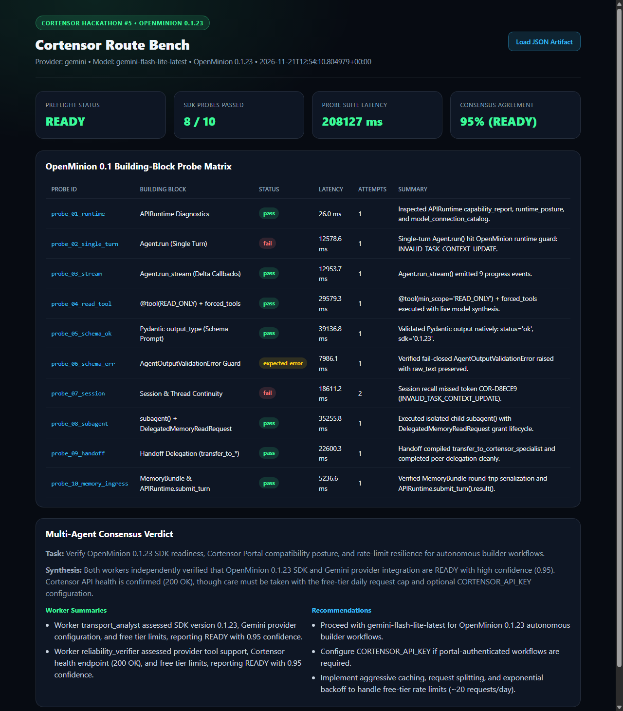

# Cortensor Route Bench

An **OpenMinion `0.1.23`** SDK building-block probe suite, Cortensor route preflight inspector, and multi-agent PoI-style consensus verifier built for **Cortensor Hackathon #5**.

## Features

- **Provider & Cortensor Route Preflight (`preflight`)**: Checks OpenMinion runtime health, environment credentials, stale preset overrides, and native tool-calling compatibility (flagging Cortensor Portal's text-in/text-out compatibility constraint).
- **10 Live SDK Building-Block Probes (`probe`)**: Measures latency and pass/fail telemetry across `APIRuntime` diagnostics, `Agent.run`, `Agent.run_stream`, `@tool(min_scope="READ_ONLY")`, Pydantic `output_type` schema coercion, `AgentOutputValidationError` guardrails, session continuity, `subagent()` + `DelegatedMemoryReadRequest`, `Handoff`, and `MemoryBundle` + `APIRuntime.submit_turn`.
- **Multi-Agent PoI-Style Consensus Verifier (`bench`)**: Launches two isolated `subagent()` workers (`transport_analyst` + `reliability_verifier`) and synthesizes agreement score, discrepancies, and readiness verdict via a `Coordinator` `Handoff`.
- **Interactive Dashboard & Auto-Docs**: Generates `artifacts/*.json`, `artifacts/BENCHMARK_REPORT.md`, `docs/BUILDING_BLOCKS_TESTED.md`, `docs/WHAT_WE_LEARNED.md`, and pairs with a standalone `index.html` viewer.

## Architecture

```text
CLI (cortensor-route-bench run-all)
 ├── Preflight Inspector ──▶ Credential, Tool-Calling & Config Checks
 ├── 10 SDK Probes ───────▶ APIRuntime / Agent / @tool / Stream / Session / subagent / Handoff / MemoryBundle
 └── Consensus Workflow
      ├── Worker A (subagent + READ_ONLY tools + DelegatedMemoryReadRequest)
      ├── Worker B (subagent + endpoint/reliability checks)
      └── Coordinator ──▶ Handoff(consensus_synthesizer) ──▶ ConsensusVerdict JSON + Reports
```

## Quick Start

```bash
python -m venv .venv
# Windows PowerShell:
.venv\Scripts\Activate.ps1
# Linux/macOS:
# source .venv/bin/activate

pip install -e ".[dev]"
cp .env.example .env
# Add your GEMINI_API_KEY (or CORTENSOR_API_KEY / OPENROUTER_API_KEY / GROQ_API_KEY) to .env

# 1. Run offline deterministic test suite
pytest

# 2. Run preflight check
cortensor-route-bench --provider gemini --model gemini-flash-lite-latest preflight

# 3. Run full live benchmark (preflight + 10 probes + multi-agent consensus + report export)
cortensor-route-bench --provider gemini --model gemini-flash-lite-latest --pace-seconds 1.5 run-all
```

## Latest Verified Run (`openminion==0.1.23` / `gemini-flash-lite-latest`)

- **Preflight:** `READY` (`sdk.version`, `provider.credentials`, `provider.tool_calling_posture`, `provider.preset_model_override`, `config.file_presence`).
- **SDK Probe Matrix (`artifacts/probe_matrix.json`):** `8/10` probes passed in `208,127.16 ms` (`probe_01`–`probe_10`, accurately flagging `INVALID_TASK_CONTEXT_UPDATE` on toolless/session-turn-2 prompts `probe_02` and `probe_07` alongside clean passes on `Agent.run_stream`, `@tool`, Pydantic `output_type`, `subagent()` + `DelegatedMemoryReadRequest`, `Handoff`, and `APIRuntime.submit_turn`).
- **Multi-Agent PoI-Style Consensus (`artifacts/live_consensus_run.json`):** Decision **`READY`** (`agreement_score = 0.95`) synthesized in `119,199.13 ms` across independent `transport_analyst` + `reliability_verifier` `subagent()` workers and Coordinator `Handoff` delegation.
- **Reports & SDK Feedback:** See [BENCHMARK_REPORT.md](artifacts/BENCHMARK_REPORT.md), [BUILDING_BLOCKS_TESTED.md](docs/BUILDING_BLOCKS_TESTED.md), [WHAT_WE_LEARNED.md](docs/WHAT_WE_LEARNED.md), and [FEEDBACK.md](FEEDBACK.md).
- **Demo Video (~74s):** https://www.youtube.com/watch?v=10P-WjQlCkw
- **Hackathon #5 PR:** https://github.com/cortensor/community-projects/pull/98



### Viewing the Dashboard

```bash
python -m http.server 8765
# Open http://localhost:8765/index.html
```

## Security & Privacy

- `.env` and `.openminion/` runtime artifacts are gitignored.
- All outputs and Markdown/JSON artifacts pass through `redact_secrets()` to strip bearer tokens and API key prefixes.
- `check_endpoint_health` restricts requests to HTTPS or loopback (`localhost` / `127.0.0.1`) URLs.
