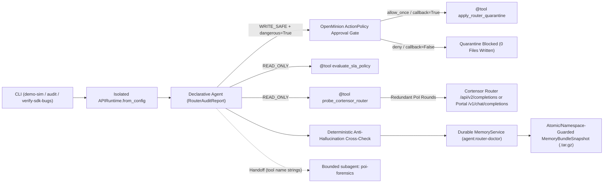

# Cortensor Router Doctor (`cortensor-router-doctor`)

> **Cortensor Hackathon #5 Submission** — An **OpenMinion `0.1.24`** Python SDK agent that performs **Cortensor Router & Node SLA diagnostics**, **Proof-of-Inference (PoI) consensus drift auditing**, **approval-gated quarantine remediation**, and **atomic cross-session durable memory portability**.

[](https://www.python.org/)
[](https://github.com/openminion/openminion)
[](LICENSE)

---

## Architecture



### Why This Agent Matters for Cortensor

In a decentralized inference network like **Cortensor**, router endpoints front heterogeneous miners where two silent failure modes can break downstream apps:
1. **Proof-of-Inference (PoI) Consensus Drift**: Redundant inference rounds for the same deterministic prompt (`temperature=0.0`) diverge across miners (dishonest, corrupted, or misconfigured nodes).
2. **SLA Degradation**: Elevated tail latency (`p95 > 500ms`) or intermittent HTTP `503` overload responses.

**Cortensor Router Doctor** combines OpenMinion `0.1.24`'s declarative `Agent`, `@tool` risk classification, `ActionPolicy` human-in-the-loop approvals, durable memory portability, and deterministic Pydantic v2 anti-hallucination validation so an LLM **cannot certify a drifting or degraded router as `HEALTHY`**, and **cannot write a quarantine directive without explicit operator approval**.

---

## Key Features

- **Local Cortensor Router v2 Simulator** (`router_sim.py`): Thread-safe `ThreadingHTTPServer` implementing `/health`, `/api/v2/completions`, and `/v1/chat/completions` with `healthy`, `poi_drift`, and `sla_degraded` node profiles.
- **3 Risk-Classified OpenMinion `@tool` Functions** (`tools.py`):
  - `probe_cortensor_router` (`min_scope="READ_ONLY"`, `idempotent=True`) — measures p50/p95 latency, HTTP success rate, exact-match ratio, and token-Jaccard PoI consensus agreement score (`0.0–1.0`).
  - `evaluate_sla_policy` (`min_scope="READ_ONLY"`, `idempotent=True`) — deterministically grades `HEALTHY`, `DEGRADED`, or `CRITICAL_DRIFT`.
  - `apply_router_quarantine` (`min_scope="WRITE_SAFE"`, `dangerous=True`, `idempotent=False`) — approval-gated write of a SHA-256 signed JSON quarantine directive.
- **Anti-Hallucination Evidence Cross-Check** (`models.py`): `RouterAuditReport` self-consistency validators + `verify_report_against_evidence()` ensure the final LLM verdict and metrics match measured tool data.
- **Both OpenMinion Execution Paths** (`agent.py`):
  - High-level declarative `Agent.run_stream(..., on_delta=..., approval_callback=..., timeout_seconds=...)`
  - Low-level `APIRuntime.submit_turn(payload={..., "deliver": False})` + `RuntimeTurnHandle.stream()` + interactive `handle.resolve_approval(approval_id=..., decision=...)` -> `TurnResponse`
  - Bounded `subagent(parent, ...)` + `Handoff` forensics delegation using string tool allowlists to avoid shared-`@tool` registry collisions.
- **Atomic & Namespace-Guarded Durable Memory Portability** (`memory_ops.py`): Uses OpenMinion's real `rt.runtime_memory_assembly.service` (`scope="agent:router-doctor"`, `record_type="fact"`) and `MemoryBundleSnapshot` `.tar.gz` export/import, wrapped with a pre-flight validator guarding against upstream OpenMinion `0.1.24` bugs ([#873](https://github.com/openminion/openminion/issues/873)).

---

## Quickstart

### 1. Install with `uv` (recommended)

```bash
uv sync --extra dev
```

Or run directly with an existing Python 3.11+ environment containing `openminion==0.1.24`.

### 2. Run Offline Test Suites (Zero External Dependencies)

```bash
uv run pytest -q
```

This runs both:
- [`tests/test_router_doctor.py`](tests/test_router_doctor.py) — full unit & integration tests (simulator, tools, anti-hallucination guard, durable memory, atomic bundle guard, `APIRuntime`, `Agent`, `Handoff`, `submit_turn`).
- [`tests/test_openminion_sdk_findings.py`](tests/test_openminion_sdk_findings.py) — minimal, reproducible proofs of all verified OpenMinion `0.1.24` SDK findings.

### 3. Run the Live Simulator Demo

#### Option A: Local Ollama (verified with `qwen2.5:1.5b` at `http://127.0.0.1:11434`)

```bash
ollama pull qwen2.5:1.5b
uv run cortensor-router-doctor demo-sim --provider ollama --model qwen2.5:1.5b
```

#### Option B: Cortensor Portal (OpenAI-compatible)

```bash
export CORTENSOR_API_KEY="your-cortensor-api-key"
uv run cortensor-router-doctor demo-sim \
  --provider cortensor-portal \
  --model gpt-oss-20b \
  --base-url https://portal.cortensor.network/v1 \
  --timeout 480
```

#### Option C: Cortensor Router v2 (`/api/v2/completions`)

```bash
export CORTENSOR_API_KEY="your-cortensor-api-key"
uv run cortensor-router-doctor demo-sim \
  --provider cortensor-router \
  --model gpt-oss-20b \
  --base-url http://127.0.0.1:8080/api/v2/completions \
  --timeout 480
```

### 4. Audit Any Live Endpoint

```bash
uv run cortensor-router-doctor audit \
  --endpoint http://127.0.0.1:8080/api/v2/completions \
  --provider ollama \
  --model qwen2.5:1.5b \
  --rounds 3 \
  --approve-quarantine
```

### 5. Verify Upstream OpenMinion `0.1.24` SDK Findings via CLI

```bash
uv run cortensor-router-doctor verify-sdk-bugs
```

---

## Upstream Contributions & Hackathon Documentation

While building `cortensor-router-doctor`, we stress-tested 10 OpenMinion `0.1.24` SDK building blocks and filed **two original upstream bug reports** on `openminion/openminion`:

- **[openminion/openminion#872](https://github.com/openminion/openminion/issues/872)** — `TurnHandle.stream(timeout_s=...)` and `subscribe(timeout_s=...)` ignore `Condition.wait()` timeout return values and loop indefinitely.
- **[openminion/openminion#873](https://github.com/openminion/openminion/issues/873)** — `MemoryMerger._import_direct_mode` performs non-atomic partial writes on `conflict_mode="error"` and silently ignores `options.namespace_allowlist`.

Full hackathon artifacts:
- **[BUILDING_BLOCKS_TESTED.md](BUILDING_BLOCKS_TESTED.md)** — Complete 10-block compatibility matrix (what worked, what broke, workarounds).
- **[WHAT_WE_LEARNED.md](WHAT_WE_LEARNED.md)** — Prioritized product & SDK recommendations, exact file/line bug reports, and concrete fix patches.
- **[outputs/live_run_receipt.json](outputs/live_run_receipt.json)** — Verified live `openminion==0.1.24` + Ollama `qwen2.5:1.5b` run receipt across all 4 scenarios (`healthy`, `poi_drift_denied`, `poi_drift_approved`, and `memory_portability`).
- **[docs/cortensor_router_doctor_demo.mp4](docs/cortensor_router_doctor_demo.mp4)** — 73-second H.264 MP4 walkthrough rendering the live run telemetry, approval allow/deny trace, signed quarantine artifact, and SDK bug proofs.
